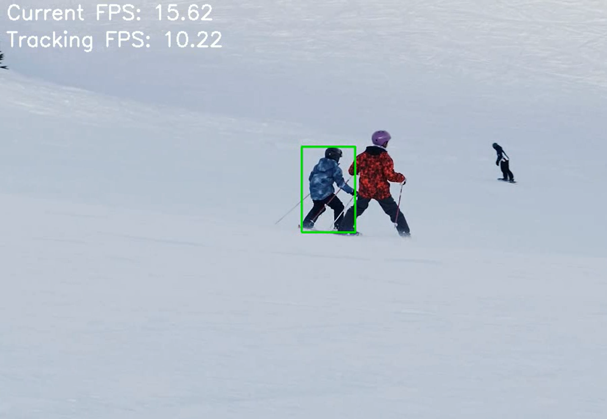
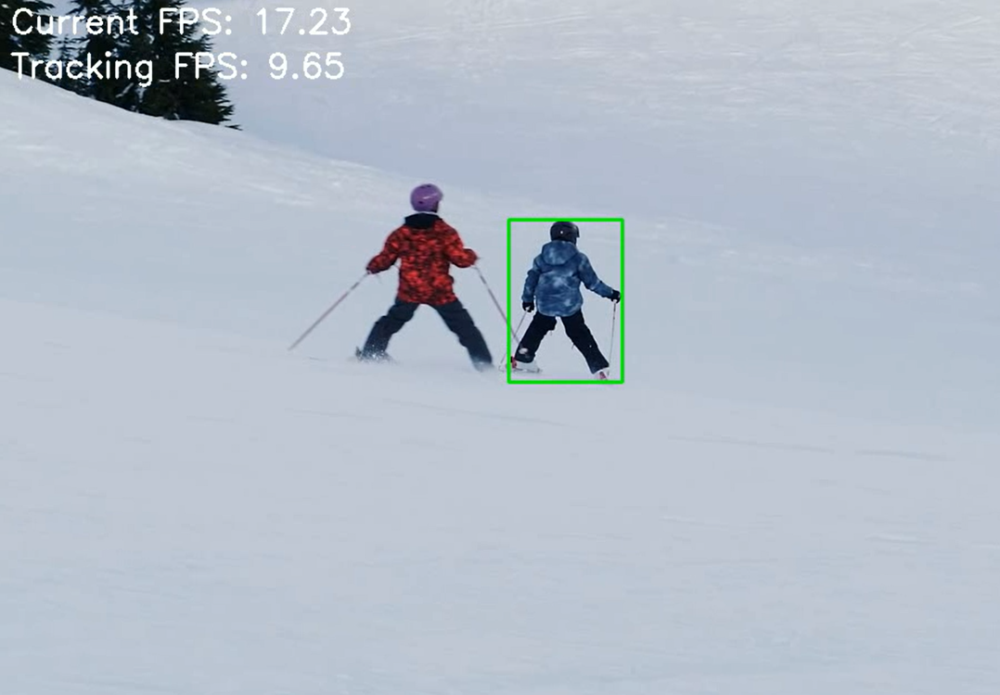
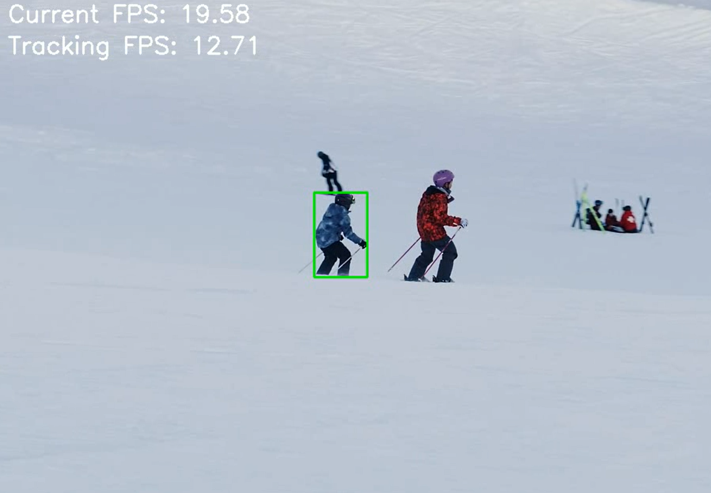
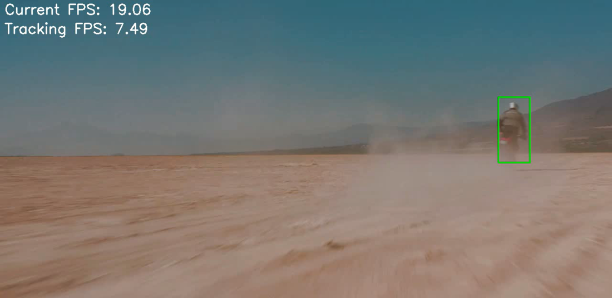
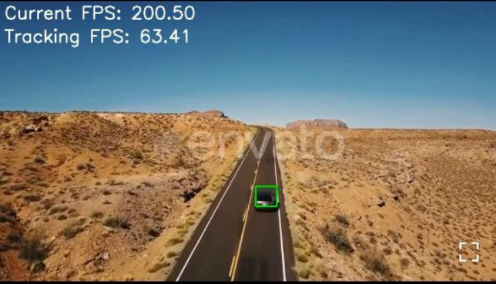

# Real-Time Object Detection and Tracking

A Signals and Systems course project at Sharif University of Technology (Spring 2025). The project combines pretrained YOLOv8n object detection with a custom frequency-domain correlation-filter tracker, **CreativeTracker**, for single-target tracking in video.

Rather than running the detector on every frame, the system searches for a user-selected object class during an initial detection window. Once a target is found, the tracker estimates its position in subsequent frames using appearance features and motion prediction.



## Method

```text
Input video -> YOLOv8n (initial detection window) -> initial bounding box
                                                        |
                                                        v
        Kalman prediction -> HOG-style + Lab features -> FFT correlation
                                                        |
                                                        v
                                              PSR confidence check
                                              /                  \
                                    Low confidence           Reliable match
                                    Prediction only     Correct position, adapt scale,
                                                        update appearance model
                                              \                  /
                                               Annotated video output
```

### CreativeTracker

- **Appearance features:** nine gradient-orientation channels derived from Sobel gradients (HOG-style features), concatenated with three normalized CIELAB color channels.
- **Frequency-domain localization:** multi-channel correlation filtering with a Gaussian target response, FFT/IFFT operations, and regularized filter estimation.
- **Motion prediction:** a four-state constant-velocity Kalman filter for object center and velocity, with position measurements from the correlation response.
- **Occlusion handling:** peak-to-sidelobe ratio (PSR) gates measurement and appearance updates; when confidence is low, the tracker falls back to the predicted position.
- **Scale adaptation:** evaluates three candidate scales and adjusts bounding-box dimensions using a weighted update.
- **Online learning:** gradually updates the filter from reliable observations. The original implementation also reinitializes filter arrays when their dimensions change.

| Parameter | Value in the submitted implementation |
|---|---:|
| Appearance update rate | 0.075 |
| Scale factor | 1.05 |
| PSR threshold | 0.05 |
| Kalman process noise covariance multiplier | 0.03 |
| Kalman measurement noise covariance multiplier | 0.5 |
| Filter regularization | 0.0001 |

## Comparison with classical trackers

The report discusses MOSSE, KCF and CSRT as classical correlation-filter tracking approaches. The notebook includes a separate **CSRT video-processing baseline** using the same initial YOLO detection strategy. MOSSE and KCF are discussed in the report and their constructors are exposed when available; separate full experimental runs for those two methods are not included in the submitted notebook.

| Method | Main approach | Qualitative trade-off discussed in the report |
|---|---|---|
| MOSSE | Grayscale correlation filter | Fast; limited handling of appearance changes |
| KCF | Kernelized correlation filter | Efficient; limited scale and occlusion handling |
| CSRT | Channel and spatial reliability | More robust tracking at greater computational cost |
| CreativeTracker | Gradient and color features, FFT correlation, Kalman prediction, PSR gating | Adaptive tracking with additional computational complexity |

This is a qualitative comparison, not a measured accuracy or speed ranking.

## Experimental results

The original project report (pp. 12–14) documents the following observations:

- A target skier was tracked before and after a temporary partial occlusion by another skier.
- The target bounding box changed in size as the skier's apparent scale changed.
- A new person entering the scene after frame 50 was not tracked, consistent with the initial-only detection design.
- Additional tracking examples show a target in a dusty scene and a car on a road.

### Recorded output frames

| Scene | Current FPS (overlay) | Tracking FPS (overlay) |
|---|---:|---:|
| Skiing, figure 1 | 17.23 | 9.65 |
| Skiing, figure 2 | 15.62 | 10.22 |
| Skiing, figure 3 | 19.58 | 12.71 |
| Dusty scene, figure 4 | 19.06 | 7.49 |
| Car tracking, figure 5 | 200.50 | 63.41 |

These are values transcribed from the original screenshots, not a controlled benchmark or whole-video average. The original notebook's running tracking-FPS calculation used an imperfect frame counter; the GitHub notebook corrects that counter. The historical screenshot values are retained as recorded and are not claimed to represent corrected measurements. Performance depends on hardware, resolution, target size and video content. No ground-truth IoU, precision, success-rate or matched quantitative baseline results are provided in the submitted report.

| Before crossing | During crossing | After crossing |
|---|---|---|
|  |  |  |

| Dusty scene | Road scene |
|---|---|
|  |  |

For the original methodology, qualitative comparison and all recorded examples, see the [full project report](reports/report.pdf).

## Run in Google Colab

1. Download or open [object_tracking.ipynb](object_tracking.ipynb) in Google Colab.
2. Execute the dependency installation cell. Restart the runtime if OpenCV was already imported and its tracker APIs are unavailable. OpenCV contrib is needed for the CSRT baseline. Avoid installing multiple OpenCV wheel variants in a clean environment because they share the `cv2` namespace.
3. Upload a video that you have permission to use. The original submission does not contain source videos or output MP4 files.
4. Choose a detectable class (for example, `person` or `car`) and enter a positive number of initial detection frames (for example, `50`).
5. Run the custom tracker cells. The notebook downloads pretrained `yolov8n.pt` if necessary (internet access required) and saves `output_video.mp4`.
6. Optionally run the CSRT baseline cell to produce `output_video_csrt.mp4`.

The notebook uses Colab's upload and download API; it is not an unmodified local Jupyter workflow. The package list is in [requirements.txt](requirements.txt). The saved report figures are from the original course submission; an end-to-end video run has not been repeated for this repository preparation.

## Repository structure

```text
real-time-object-tracking/
├── README.md
├── object_tracking.ipynb
├── requirements.txt
├── .gitignore
├── reports/
│   └── report.pdf
└── figures/
    ├── skiing-01.png
    ├── skiing-02.png
    ├── skiing-03.png
    ├── dust-scene.png
    └── car-tracking.png
```

## Scope and limitations

- Single-target tracking, not multi-object tracking. Detection stops after the first matching object is found.
- The motion model assumes approximately constant velocity and does not explicitly re-detect a lost target after initialization.
- PSR and scale parameters are fixed; robust behavior under severe occlusion or long-term target loss has not been quantitatively established.
- For repository preparation, the `CreativeTracker` class was preserved unchanged. Notebook edits are limited to dependency setup, imports, optional OpenCV tracker API compatibility, accurate counting of tracking frames for the running FPS overlay, and section headings. Stale session outputs were cleared. The custom class was smoke-tested on a synthetic image; the full video pipeline was not rerun.
- The report is reproduced with student numbers removed from the cover. The experimental content is unchanged. Example images are resized copies of report illustrations. The underlying footage is not included; confirm publication rights for any third-party footage or derived images before making the repository public.

## Authors

- Sarvin Moosavi
- Armin Tavakoli
- Aynaz Rezaeizadeh

Electrical Engineering Department, Sharif University of Technology.

Original collaborative repository: [Signal_Project](https://github.com/armin-tavakoli/Signal_Project).
