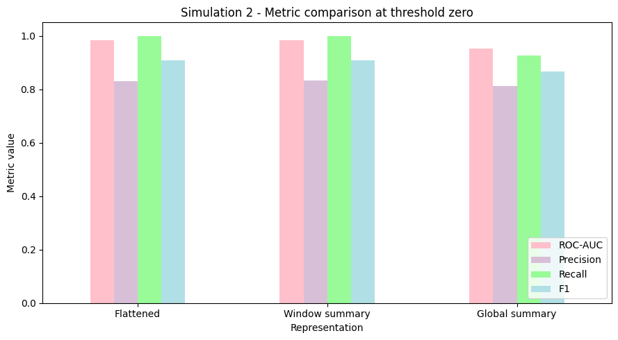
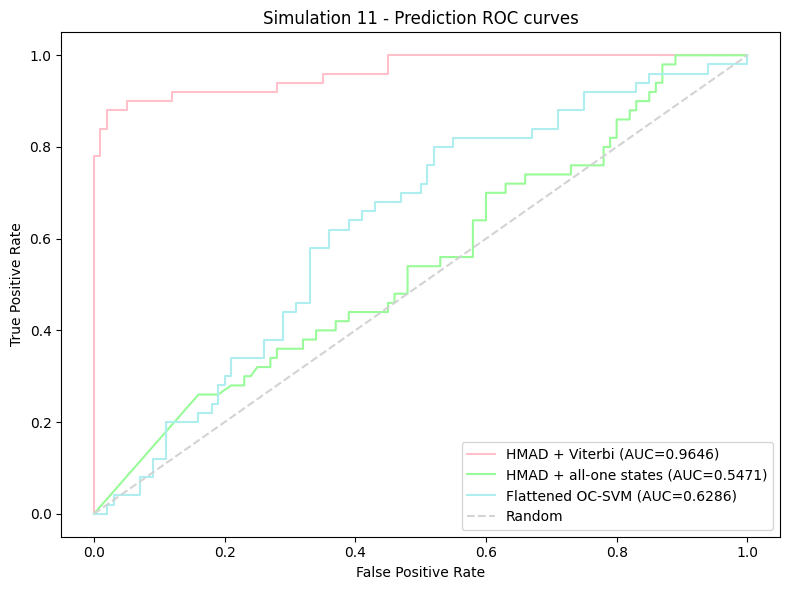
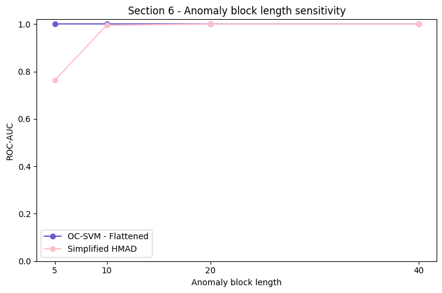
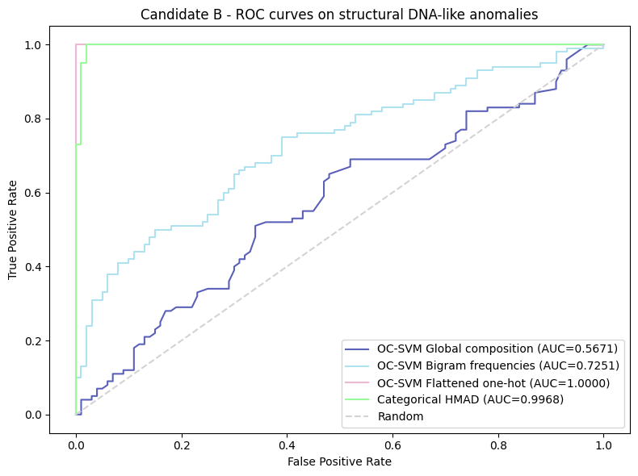
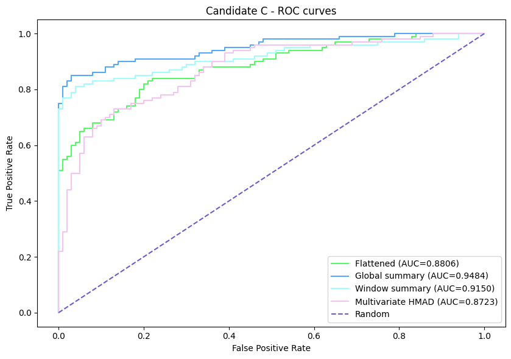

# Sequence Anomaly Detection: From OC-SVM to Hidden Markov Models

Machine learning course project, Sharif University of Technology, Spring 2026 (1405).

This project investigates when explicitly modeling latent temporal structure improves one-class anomaly detection over conventional fixed-vector representations. It compares RBF One-Class SVM (OC-SVM) with a simplified Hidden Markov Anomaly Detection (HMAD) framework on ECG5000 and controlled synthetic datasets, including categorical bioinformatics-inspired sequences and multivariate wind turbine simulations.

## Methods

- OC-SVM baselines with flattened sequences, global statistics and window-level statistics; feature scaling fitted on training data only.
- Markov chains, Gaussian HMMs and log-domain Viterbi decoding; experiments on numerical underflow and latent state recovery.
- Simplified HMAD: infer hidden paths, construct joint features from normalized transition counts and state-dependent mean emissions, and train an OC-SVM on those features. Iteratively update the HMM using decoded states. The categorical and multivariate experiments extend the representation to their respective observation types.
- Evaluation using ROC-AUC, precision, recall, F1, confusion matrices and sensitivity experiments. Labels are used to evaluate test predictions, not to fit the one-class models.

## 1. ECG5000: real ECG heartbeat sequences

The original training/test split was retained. Class 1 was treated as normal and classes 2–5 as anomalies.

| Training (normal only) | Test | Normal test | Anomalous test | Sequence length |
| ---: | ---: | ---: | ---: | ---: |
| 292 | 4,500 | 2,627 | 1,873 | 140 |

Results at `nu = 0.10` (from saved notebook outputs and Sections 3–5 of the report):

| Method | ROC-AUC | Precision | Recall | F1 |
| --- | ---: | ---: | ---: | ---: |
| OC-SVM, flattened | **0.9840** | 0.8314 | 0.9979 | 0.9071 |
| OC-SVM, window summary | 0.9823 | 0.8319 | 0.9984 | **0.9075** |
| OC-SVM, global summary | 0.9518 | 0.8124 | 0.9274 | 0.8661 |
| HMAD with Viterbi | 0.9577 | **0.8419** | 0.9466 | 0.8912 |
| HMAD, all-one states (ablation) | 0.5000 | 0.4162 | 1.0000 | 0.5878 |

Flattened OC-SVM performed best in ROC-AUC. HMAD achieved slightly higher precision and fewer false positives (333 vs. 379), but lower recall and more false negatives (100 vs. 4). Thus, latent modeling did not outperform the strongest baseline overall on this benchmark.



## 2. Controlled synthetic HMM experiment

A two-state Gaussian HMM was used to study temporal anomalies with disrupted transition patterns. Training used 200 normal sequences of length 100; evaluation used 100 normal and 50 anomalous sequences. The training experiment recovered 99.53% of latent states (with the experiment's state labeling) and stopped after two iterations.

| Method | ROC-AUC | Precision | Recall | F1 |
| --- | ---: | ---: | ---: | ---: |
| HMAD with Viterbi | **0.9646** | **0.7077** | 0.9200 | **0.8000** |
| HMAD, all-one states | 0.5471 | 0.3333 | 1.0000 | 0.5000 |
| Flattened OC-SVM, same data | 0.6286 | 0.4677 | 0.5800 | 0.5179 |

Here the temporal representation substantially improves detection over the same-data flattened baseline. Removing the inferred state path reduces ROC-AUC by 0.4175.



## 3. Synthetic Gaussian sequences (Section 6, Candidate A)

The required experiment uses 200 normal training sequences and 100 test sequences of length 100. Normal observations follow N(0, 1); anomalous blocks follow N(4, 1). At 10% test anomalies and a block length of 20:

| Method | ROC-AUC | Precision | Recall | F1 |
| --- | ---: | ---: | ---: | ---: |
| OC-SVM, flattened | 1.0000 | 0.2041 | 1.0000 | 0.3390 |
| OC-SVM, global summary | 1.0000 | 0.3571 | 1.0000 | 0.5263 |
| OC-SVM, window summary | 1.0000 | 0.2326 | 1.0000 | 0.3774 |
| Simplified HMAD | 1.0000 | **0.3704** | 1.0000 | **0.5405** |

All methods rank the anomalies perfectly in this specific setting, but their threshold-based precision differs. The following separate sensitivity experiment shows the effect of anomaly duration:

| Block length | Flattened OC-SVM ROC-AUC | HMAD ROC-AUC |
| ---: | ---: | ---: |
| 5 | 1.0000 | 0.7633 |
| 10 | 1.0000 | 0.9956 |
| 20 | 1.0000 | 1.0000 |
| 40 | 1.0000 | 1.0000 |

The notebook also varies the test anomaly fraction (1%, 5%, 10%, 20%) and number of anomalous blocks (1–3). The Gaussian HMAD run reached its 10-iteration limit, and the learned transitions approached an identity matrix; perfect ranking on strong mean-shift anomalies should not be interpreted as reliable latent state recovery.



## 4. Bioinformatics-inspired categorical sequences (Candidate B, bonus)

Synthetic sequences of length 120, with four categorical symbols and four latent functional states. Structural anomalies are created by disrupting sequence order. The experiment uses 200 normal training and 200 test sequences (100 anomalous).

| Method | ROC-AUC | Precision | Recall | F1 |
| --- | ---: | ---: | ---: | ---: |
| OC-SVM, global composition | 0.5671 | 0.6129 | 0.1900 | 0.2901 |
| OC-SVM, bigram frequencies | 0.7251 | 0.7286 | 0.5100 | 0.6000 |
| OC-SVM, flattened one-hot | **1.0000** | 0.7246 | 1.0000 | 0.8403 |
| Categorical HMAD | 0.9968 | **0.8197** | 1.0000 | **0.9009** |

The categorical HMAD has the highest F1 at the evaluated decision threshold, although flattened one-hot OC-SVM has slightly higher ROC-AUC. These are simulated biological-style sequences, not real genomic data.



## 5. Multivariate wind turbine simulation (Candidate C, bonus)

Synthetic wind-speed, gearbox-vibration and gearbox-temperature sequences, with two operating states and three injected anomaly types (wind shift, high turbulence and mechanical fault). Training: 200 normal sequences. Test: 200 sequences, 100 anomalous. Length: 100 time steps.

| Method | ROC-AUC | Precision | Recall | F1 |
| --- | ---: | ---: | ---: | ---: |
| OC-SVM, flattened | 0.8806 | 0.6929 | 0.8800 | 0.7753 |
| OC-SVM, global summary | **0.9484** | 0.7845 | **0.9100** | **0.8426** |
| OC-SVM, window summary | 0.9150 | 0.7417 | 0.8900 | 0.8091 |
| Multivariate HMAD | 0.8723 | **0.8132** | 0.7400 | 0.7749 |

The global-summary baseline performs best overall; HMAD has the highest precision. Additional experiments compare anomaly types and block lengths. No real turbine sensor data are used.



## Key takeaways

- The best representation depends on the anomaly mechanism: OC-SVM performs strongly for distinctive waveform shapes and large mean shifts, whereas latent-state modeling helps when anomalous transition structure is the main signal.
- The Viterbi ablations show the value of inferred state paths in the implemented HMAD model.
- ROC-AUC measures score ranking; it does not guarantee high precision or F1 at a fixed decision threshold.
- These are academic benchmark experiments, not a clinically validated ECG diagnostic system. Results reflect the saved experimental runs and are not cross-dataset generalization guarantees.

## Repository contents

| File / folder | Purpose |
| --- | --- |
| [`ML_Project.ipynb`](ML_Project.ipynb) | Original notebook with saved outputs, all simulation questions and bonus experiments |
| `generate_data.py` | Course-provided synthetic Gaussian data helper |
| `prepare_ecg5000.py` | Recreates the exact ECG5000 arrays used by the notebook from source files |
| `ECG5000_prepared/metadata.json` | Dataset and label definitions |
| `requirements.txt` | Python dependencies |
| `figures/` | Selected figures extracted from saved notebook outputs |
| `reports/` | Persian project reports with full methodology and results |

## How to run

With Python 3 installed, open a terminal in the repository root:

```bash
python -m pip install -r requirements.txt
python prepare_ecg5000.py
python -m jupyter notebook ML_Project.ipynb
```

Run the notebook cells in order from the repository root. The preparation script downloads the two official `.ts` files, verifies their checksums, and creates `ECG5000_prepared/ecg5000_oneclass.npz`. If the download is unavailable, manually obtain the files from the dataset link below and place them in `ECG5000_prepared/raw/`, then run the preparation script. Synthetic datasets are generated by the code. Running the notebook creates a local `Results/` directory; generated data and outputs are excluded by `.gitignore`. The saved notebook outputs can be viewed without running the experiments. Exact dependency versions from the original run were not recorded in the supplied files.

## Reports

- [Sections 1–5: Theory, OC-SVM, HMMs and HMAD experiments (PDF)](reports/Report_Section_1_to_5.pdf)
- [Section 6: Required and bonus experiments (PDF)](reports/Report_Section_6.pdf)

## Dataset and attribution

- [ECG5000 — UCR/UEA archive dataset record](https://doi.org/10.5281/zenodo.11186692), maintained by the TSML Archive Maintainers. Raw dataset files are not redistributed in this repository.
- [UCR Time Series Classification Archive](https://www.cs.ucr.edu/~eamonn/time_series_data_2018/).
- [Original project data mirror (AutonLab/Timeseries-PILE)](https://huggingface.co/datasets/AutonLab/Timeseries-PILE/tree/main/classification/UCR/ECG5000).
- Course-provided data-generation helper is attributed to the course materials; no claim of original authorship is made for that helper.

## Authors

Aynaz Rezaeizadeh and Fatemeh Hassanpour Amiri — undergraduate course project, Sharif University of Technology. 
